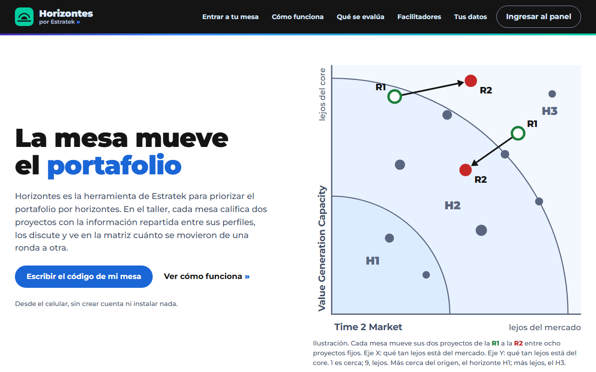
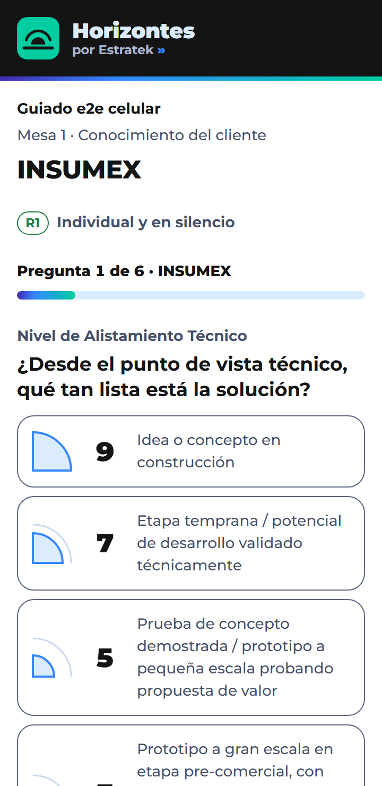
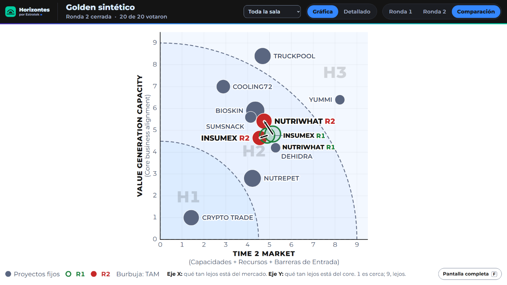
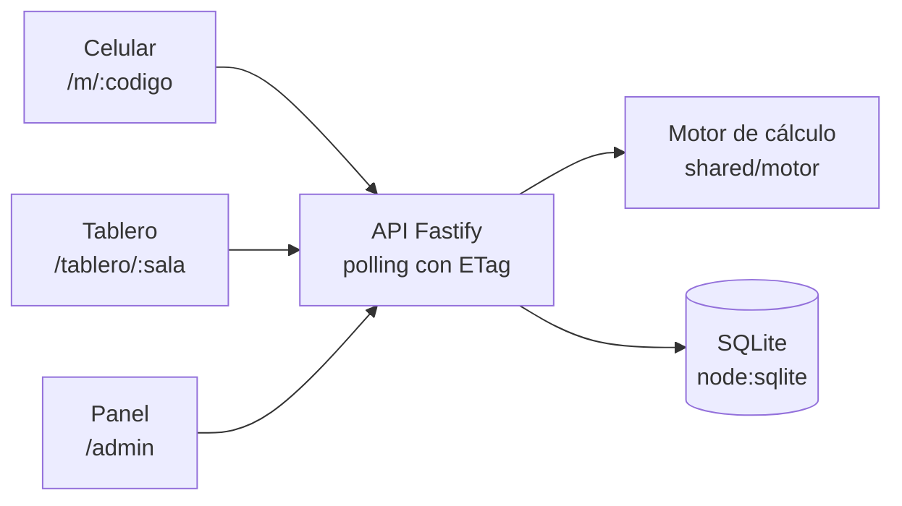

# Horizontes

Horizontes es la herramienta de Estratek para priorizar el portafolio por horizontes, hecha para el taller **Portafolio por Horizontes**. Cada mesa de un taller simula una empresa: sus participantes leen el caso Foodsume en el celular, reciben una hoja de información según su perfil y califican dos proyectos vivos (INSUMEX y NUTRIWHAT) en seis criterios, en dos rondas. La matriz de burbujas muestra cuánto se movieron los proyectos entre la ronda 1 (individual y en silencio) y la ronda 2 (con discusión en la mesa).

<table>
  <tr>
    <td width="42%"></td>
    <td width="16%"></td>
    <td width="42%"></td>
  </tr>
  <tr>
    <td align="center">Landing (<code>/</code>)</td>
    <td align="center">Celular (<code>/m/:codigo</code>)</td>
    <td align="center">Tablero (<code>/tablero/:sala</code>)</td>
  </tr>
</table>

## Probarlo en 2 comandos
Con Node 24:

```bash
npm ci
npm run dev        # http://localhost:5173 con la API simulada (mocks)
```

## Arquitectura



Una sola SPA de React (Vite) reúne las cuatro vistas; el servidor Fastify sirve la SPA y la API. El motor vive solo en el servidor: el frontend nunca recalcula.

| Ruta | Para quién |
|---|---|
| `/` | Landing pública: qué es, cómo funciona y entrada con el código de la mesa |
| `/m/:codigo` | Participante (celular): inscripción, caso, hoja, votación y resultados |
| `/tablero/:sala` | Tablero para el proyector (enlace con token que comparte el facilitador) |
| `/admin` | Panel del facilitador: salas, mesas y QR, rondas, configuración, rúbricas y exportes |

## Stack
Node 24 · Fastify 5 · TypeScript (`tsx`) · SQLite (`node:sqlite`) · React 18 · Vite 6 · react-router 7 · Vitest 3. Tiempo real por polling con ETag. Despliegue con Docker en Coolify (VPS de Hostinger). Detalle en [`docs/STACK.md`](docs/STACK.md).

## Empezar
Requisitos: Node 24 y Git Bash en Windows.

```bash
npm ci
npm run dev        # web en http://localhost:5173 con API simulada (mocks)
npm run dev:api    # web + API real con SQLite local
```

Para la API real, crea un `.env` (nunca se sube) con `SUPERADMIN_USUARIO` y `SUPERADMIN_CLAVE`; el superadmin se crea al arrancar sobre una base vacía. Para una sala de prueba:

```bash
npm run seed -- --sala "Taller de prueba" --mesas 3
```

## Pruebas

```bash
bash tools/test.sh   # typecheck + todas las pruebas (servidor, motor, UI y navegador)
```

Las pruebas en navegador necesitan Chromium (`npx playwright-core install chromium-headless-shell`); con `HZ_E2E=0` se omiten. El golden del motor (`tests/golden/motor_golden.json`) debe pasar al 100 %. Simulador de carga: `npm run simular` (40 personas) y `npm run ensayo` (taller completo con cierres programados).

## Despliegue
`tools/deploy.sh verificar | local | staging | produccion`. Producción se despliega a mano (Auto Deploy apagado). Guía completa en [`docs/DESPLIEGUE.md`](docs/DESPLIEGUE.md); pasos pendientes de puesta en marcha en [`docs/ENTREGA.md`](docs/ENTREGA.md).

## Flujo de trabajo
Ramas, commits, pull requests, reglas del contrato y del motor, datos personales y definición de terminado: [`CONTRIBUTING.md`](CONTRIBUTING.md).

## Documentación
| Documento | Contenido |
|---|---|
| [`docs/SPEC.md`](docs/SPEC.md) | Especificación funcional |
| [`docs/ACTA_2026-10-16.md`](docs/ACTA_2026-10-16.md) | Decisiones del 16-oct que mandan sobre la SPEC |
| [`docs/CONTRATO_API.md`](docs/CONTRATO_API.md) · [`docs/MODELO_DATOS.md`](docs/MODELO_DATOS.md) | API y base de datos |
| [`docs/DECISIONES.md`](docs/DECISIONES.md) | Registro de decisiones |
| [`docs/DISENO.md`](docs/DISENO.md) | Sistema de diseño |
| [`docs/CONSENTIMIENTO.md`](docs/CONSENTIMIENTO.md) | Aviso de datos por país |
| [`docs/GUIA_FACILITADOR.md`](docs/GUIA_FACILITADOR.md) · [`docs/PLAN_B.md`](docs/PLAN_B.md) | Operación del taller |
| [`docs/DESPLIEGUE.md`](docs/DESPLIEGUE.md) · [`docs/ENTREGA.md`](docs/ENTREGA.md) · [`docs/MIGRACION_GITHUB.md`](docs/MIGRACION_GITHUB.md) | Infraestructura |

## In English
Horizontes is Estratek's web tool for portfolio prioritization by horizons (H1 core, H2 adjacent, H3 transformation).
It runs the in-person workshop «Portafolio por Horizontes»: each table plays a company and reads the Foodsume case on their phones.
Every participant gets a profile sheet with information only that profile knows, so the table must talk to see the whole picture.
They score two live projects on six criteria with a 1-3-5-7-9 scale, first alone and in silence (round 1), then after discussing (round 2).
The server averages each criterion and places both projects on a Time 2 Market vs. Value Generation Capacity bubble matrix.
The projector board shows how the projects moved from round 1 to round 2 among eight fixed reference projects.
Results only appear with at least 3 votes, and public views never show names or individual scores.
Facilitators run rooms, tables, QR codes, rounds and exports from an admin panel.
Stack: Node 24, Fastify 5, SQLite (node:sqlite), React 18 and Vite 6, with polling and ETags instead of websockets.
Try it locally with `npm ci` and `npm run dev`; the app and its documentation are in Spanish.

---
Estratek S.A.S. · Medellín, Colombia
